# Информационная безопасность

## Теоретический материал. Информатика. 9 класс. Урок 2

---

## 1. Понятие информационной безопасности

### 1.1. Определение

На прошлом уроке мы выяснили, что Интернет — это глобальная сеть, по которой ежесекундно передаются миллиарды пакетов данных. Среди этих данных — ваши пароли, личные сообщения, фотографии, номера банковских карт, переписка. Возникает естественный вопрос: **как защитить всё это от посторонних?**

> **Определение.** **Информационная безопасность** — состояние защищённости информации и данных от несанкционированного доступа, использования, разглашения, подмены, искажения или уничтожения.

Информационная безопасность обеспечивает три ключевых свойства данных:

| Свойство | Суть | Пример нарушения |
|----------|------|-----------------|
| **Конфиденциальность** | Данные доступны только тем, кому они предназначены | Злоумышленник получил доступ к вашей переписке |
| **Целостность** | Данные не изменены без ведома владельца | Кто-то отредактировал ваш документ в облачном хранилище |
| **Доступность** | Владелец может пользоваться своими данными в нужный момент | Вирус-шифровальщик заблокировал доступ к файлам |

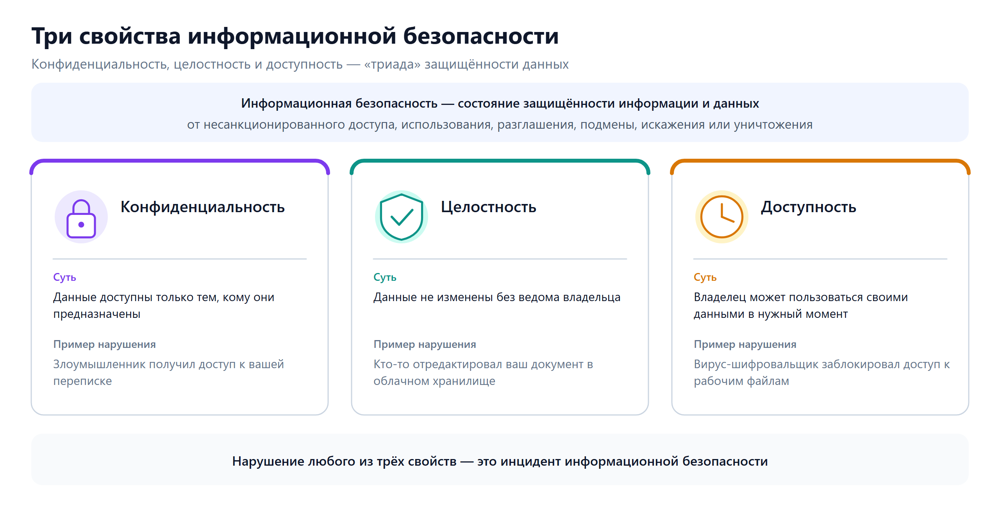{width=1280px height=650px}

**Рисунок 22 — Конфиденциальность, целостность и доступность: суть каждого свойства и пример его нарушения**

### 1.2. Два типа угроз

Все угрозы информационной безопасности можно разделить на две большие группы:

- **Технические угрозы** — связаны с уязвимостями программного обеспечения, вредоносным кодом, перехватом трафика. Противодействуют им с помощью антивирусов, шифрования, обновлений.
- **Социально-психологические угрозы** — направлены не на технику, а на человека: манипулирование, обман, давление на эмоции. Противодействуют им критическое мышление, осведомлённость и осторожность.

> **Важно.** По данным специалистов, более 70 % успешных кибератак начинаются с манипуляции человеком, а не со взлома техники. Поэтому знания и внимательность пользователя — главная линия обороны.

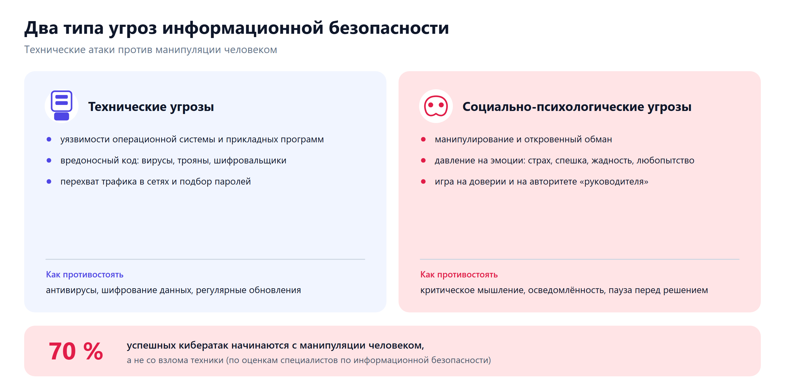{width=1300px height=650px}

**Рисунок 23 — Чем технические угрозы отличаются от манипуляции человеком и как им противостоять**

---

## 2. Основные угрозы при работе в глобальной сети

### 2.1. Вредоносное программное обеспечение

**Вредоносное ПО** (англ. *malware*) — программы, созданные для нанесения вреда пользователю, его данным или устройству.

Основные виды вредоносного ПО:

| Вид | Что делает | Пример |
|-----|-----------|--------|
| **Вирус** | Присоединяется к другим программам и распространяется при их запуске | Файл-вложение в письме, при открытии которого заражается компьютер |
| **Троян** | Маскируется под полезную программу, но выполняет скрытые вредоносные действия | Игра или утилита, которая тайно отправляет пароли злоумышленнику |
| **Шифровальщик (вымогатель)** | Шифрует файлы пользователя и требует выкуп за расшифровку | Все документы на диске становятся нечитаемыми, появляется требование оплаты |
| **Шпион (spyware)** | Скрытно собирает информацию о действиях пользователя | Записывает нажатия клавиш, перехватывает пароли |
| **Рекламное ПО (adware)** | Показывает навязчивую рекламу, перенаправляет на рекламные сайты | Браузер постоянно открывает нежелательные вкладки |

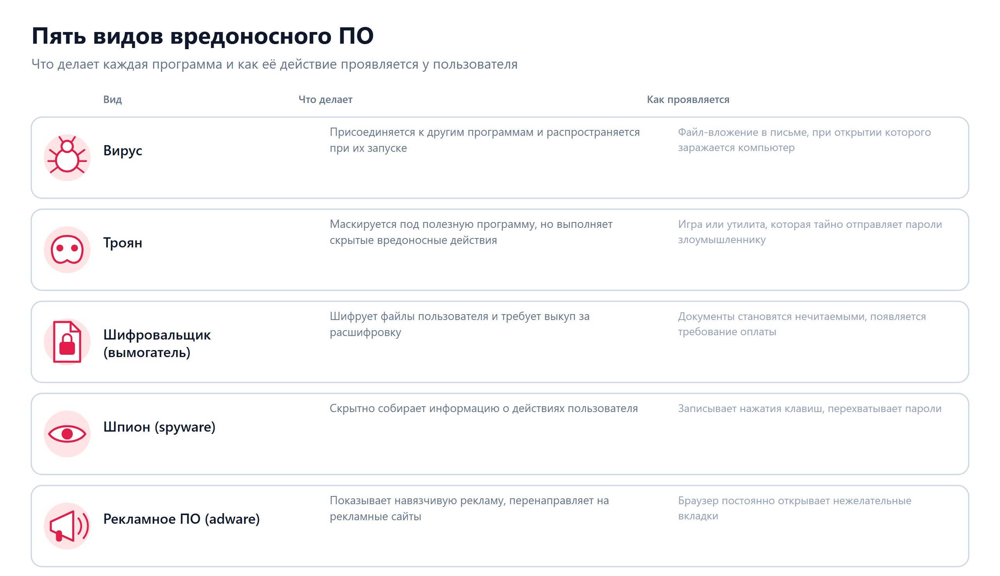{width=1280px height=738px}

**Рисунок 24 — Вирус, троян, шифровальщик, шпион и рекламное ПО: что каждый делает и как проявляется**

**Как вредоносное ПО попадает на устройство:**
- скачивание файлов из непроверенных источников;
- открытие вложений в подозрительных письмах;
- переход по вредоносным ссылкам;
- использование заражённых USB-накопителей;
- посещение сайтов с уязвимостями.

**Меры защиты:**
- использование и регулярное обновление антивирусного ПО;
- обновление операционной системы и программ;
- скачивание файлов только с официальных сайтов;
- отключение автоматического запуска с внешних носителей.

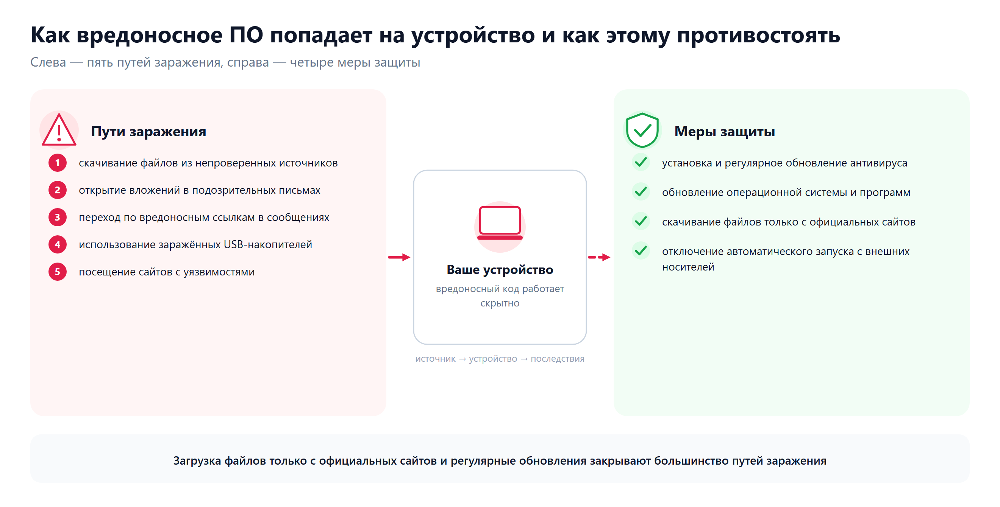{width=1320px height=670px}

**Рисунок 25 — Пять путей заражения и четыре меры защиты, которые их закрывают**

### 2.2. Фишинг

> **Определение.** **Фишинг** (от англ. *fishing* — «рыбная ловля», «выуживание») — вид интернет-мошенничества, при котором злоумышленники создают поддельные сайты, электронные письма или сообщения, имитирующие известные организации, с целью выманивания у пользователя паролей, данных банковских карт или другой конфиденциальной информации.

**Типичные признаки фишинга:**

1. **Срочность и давление.** «Ваш аккаунт будет заблокирован через 2 часа!», «Немедленно подтвердите данные, иначе потеряете доступ!»
2. **Поддельный адрес отправителя.** Адрес похож на настоящий, но содержит ошибки или лишние символы: `support@sberbank-secure.com` вместо `support@sberbank.ru`.
3. **Поддельная ссылка.** Текст ссылки выглядит как настоящий, но при наведении курсора видно, что она ведёт на другой сайт.
4. **Запрос конфиденциальных данных.** Просят ввести пароль, код из СМС, номер карты, CVV-код.
5. **Грамматические ошибки и нестандартное оформление.** Текст содержит опечатки, логотип размыт, шрифты отличаются от фирменных.

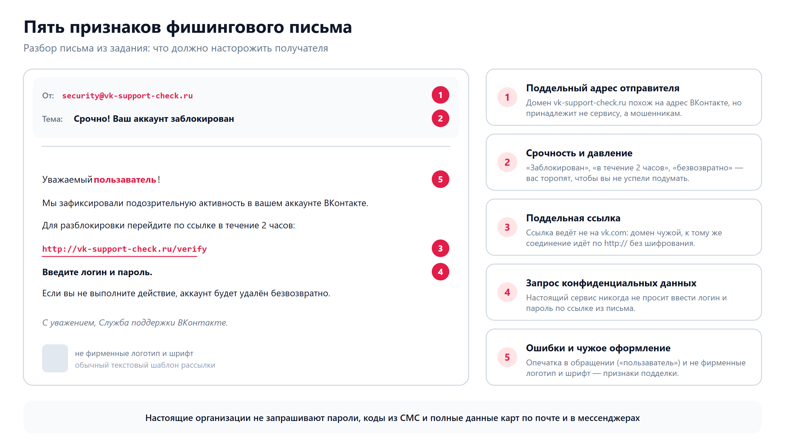{width=1340px height=760px}

**Рисунок 26 — Разбор поддельного письма: адрес отправителя, срочность, ссылка, запрос пароля, ошибки оформления**

**Правило:** настоящие организации **никогда** не запрашивают пароли, коды из СМС и полные данные банковских карт по электронной почте, в мессенджерах или по телефону.

### 2.3. Социальная инженерия

> **Определение.** **Социальная инженерия** — метод манипулирования людьми с целью получения конфиденциальной информации или совершения определённых действий, основанный на использовании доверия, страха, любопытства или авторитета.

В отличие от технических атак, социальная инженерия не взламывает компьютеры — она «взламывает» людей.

**Примеры приёмов социальной инженерии:**

| Приём | Описание |
|-------|----------|
| **Претекстинг** | Злоумышленник придумывает правдоподобный предлог: звонит «из службы безопасности банка», «из техподдержки» |
| **Фишинг по телефону (вишинг)** | Голосовые звонки с требованием назвать код из СМС или данные карты |
| **Кви про кво** («услуга за услугу») | «Я помогу вам решить проблему, если вы сообщите мне пароль» |
| **Дорожное яблоко** | Подброшенная флешка с надписью «Зарплатная ведомость» — при подключении к компьютеру устанавливается вредоносное ПО |

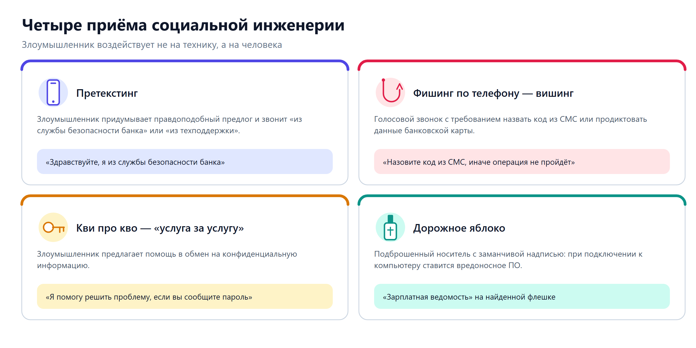{width=1280px height=640px}

**Рисунок 27 — Претекстинг, вишинг, «кви про кво» и «дорожное яблоко» с примерами реплик мошенника**

**Как противостоять:**
- Не сообщайте пароли, коды из СМС, данные карт никому и ни при каких обстоятельствах.
- Если вам звонят «из банка» или «из полиции» с тревожной информацией — положите трубку и перезвоните по официальному номеру организации.
- Не подключайте к компьютеру неизвестные носители информации.
- Не принимайте решений в состоянии спешки или стресса. Возьмите паузу.

### 2.4. Перехват данных в незащищённых сетях

При подключении к открытой (незащищённой) сети Wi-Fi — например, в кафе, торговом центре или аэропорту — злоумышленник, находящийся в той же сети, может перехватывать передаваемые данные: пароли, сообщения, историю посещённых сайтов.

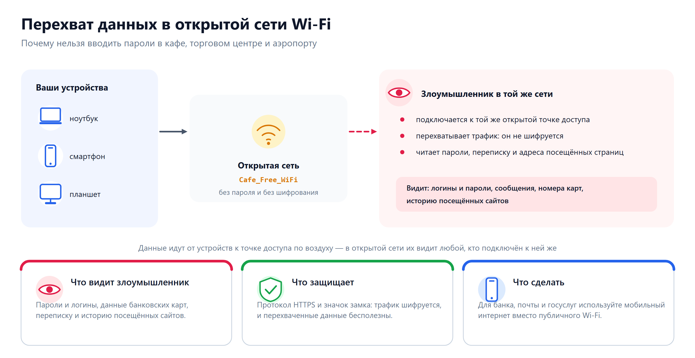{width=1320px height=680px}

**Рисунок 28 — Кто и что видит в открытой сети, почему защищает HTTPS и что делать вместо публичного Wi-Fi**

**Меры защиты:**
- Не вводите пароли и данные карт при использовании открытого Wi-Fi.
- Обращайте внимание на значок замка и протокол **HTTPS** в адресной строке браузера.
- По возможности используйте мобильный интернет вместо публичного Wi-Fi для финансовых операций.

### 2.5. Утечки данных

Иногда базы данных крупных сервисов (социальных сетей, интернет-магазинов, форумов) подвергаются взлому, и персональные данные миллионов пользователей попадают в открытый доступ.

**Что делать, если вы узнали об утечке:**
- Немедленно смените пароль на данном сервисе.
- Если вы использовали тот же пароль на других сайтах — смените его и там.
- Включите двухфакторную аутентификацию.
- Следите за подозрительной активностью в своих аккаунтах.

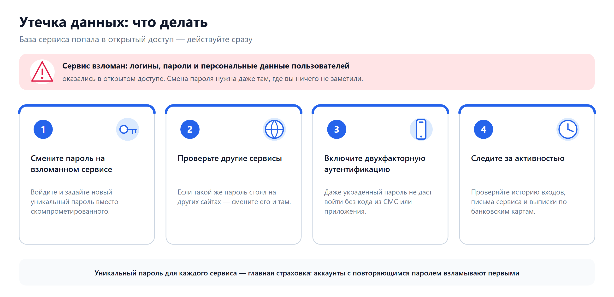{width=1280px height=620px}

**Рисунок 29 — Четыре шага после сообщения о взломе сервиса: пароли, другие аккаунты, 2ФА, контроль активности**

---

## 3. Правила безопасной аутентификации

### 3.1. Что такое аутентификация

> **Определение.** **Аутентификация** — процесс подтверждения подлинности пользователя при входе в систему, аккаунт или сервис. Проще говоря, это доказательство того, что вы действительно тот, за кого себя выдаёте.

Способы аутентификации:

| Фактор | Пример | Уровень защиты |
|--------|--------|----------------|
| **Что вы знаете** | Пароль, PIN-код, кодовое слово | Базовый |
| **Что у вас есть** | Телефон (код из СМС), электронный ключ, приложение-аутентификатор | Повышенный |
| **Что вы собой представляете** | Отпечаток пальца, распознавание лица, сканирование сетчатки глаза | Высокий |

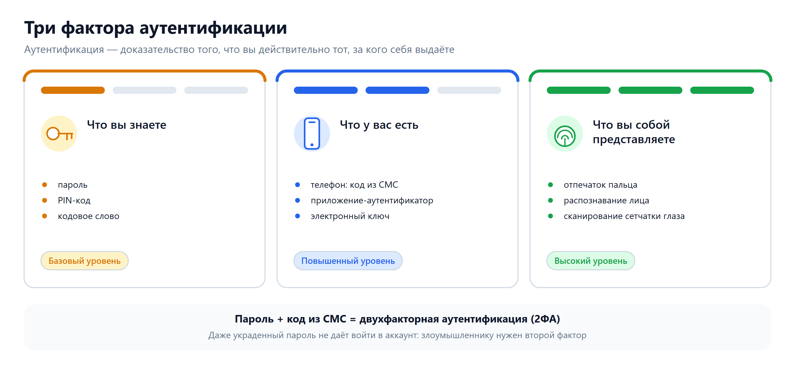{width=1320px height=610px}

**Рисунок 30 — Что вы знаете, что у вас есть, что вы собой представляете — и уровни защиты этих факторов**

### 3.2. Правила создания и использования паролей

1. **Длина.** Пароль должен содержать не менее **8–12 символов**. Чем длиннее пароль, тем сложнее его подобрать.

2. **Сложность.** Используйте сочетание:
   - заглавных букв (A, B, C…);
   - строчных букв (a, b, c…);
   - цифр (0–9);
   - специальных символов (!, @, #, $, %, &, *…).

3. **Уникальность.** Для каждого сервиса используйте **отдельный пароль**. Если один пароль будет скомпрометирован, остальные аккаунты останутся в безопасности.

4. **Запрещённые пароли.** Никогда не используйте:
   - дату рождения, имя, фамилию;
   - последовательности: `123456`, `111111`, `qwerty`, `password`;
   - название сайта или сервиса.

5. **Двухфакторная аутентификация (2ФА).** Везде, где возможно, включайте дополнительный способ подтверждения входа: код из СМС, приложение-аутентификатор или аппаратный ключ. Даже если пароль будет украден, злоумышленник не сможет войти без второго фактора.

6. **Никому не сообщайте.** Ни пароли, ни коды из СМС нельзя сообщать никому — ни «службе поддержки», ни «другу», ни «сотруднику банка».

7. **Менеджер паролей.** Для хранения множества сложных паролей используйте специальные программы — менеджеры паролей. Они генерируют надёжные пароли и хранят их в зашифрованном виде.

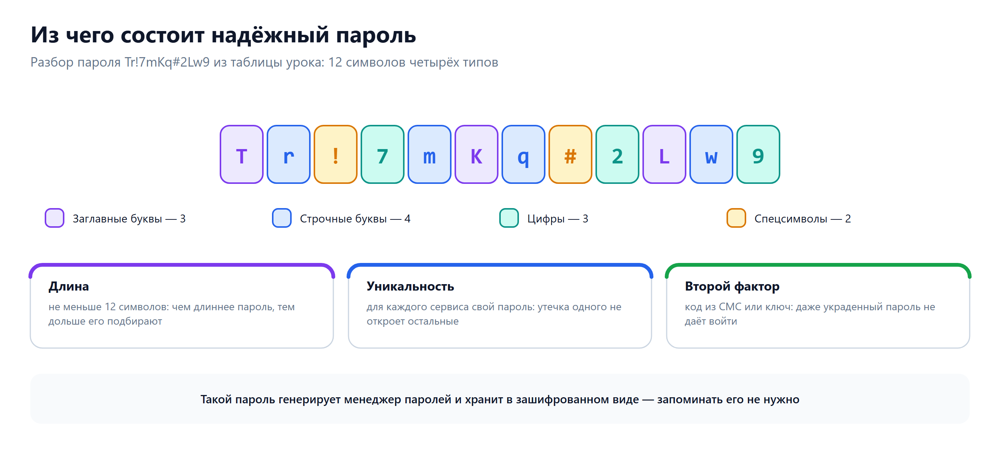{width=1320px height=600px}

**Рисунок 31 — Разбор пароля Tr!7mKq#2Lw9 по типам символов, длина, уникальность и второй фактор**

### 3.3. Пример анализа пароля

| Пароль | Оценка | Причина |
|--------|--------|---------|
| `123456` | Очень слабый | Короткий, очевидная последовательность |
| `qwerty` | Очень слабый | Раскладка клавиатуры, легко угадать |
| `Ivan1990` | Слабый | Имя + год рождения, легко подобрать |
| `P@ssw0rd` | Средний | Есть замены, но слово «password» узнаваемо |
| `Tr!7mKq#2Lw9` | Надёжный | Длинный, случайный набор символов разного типа |

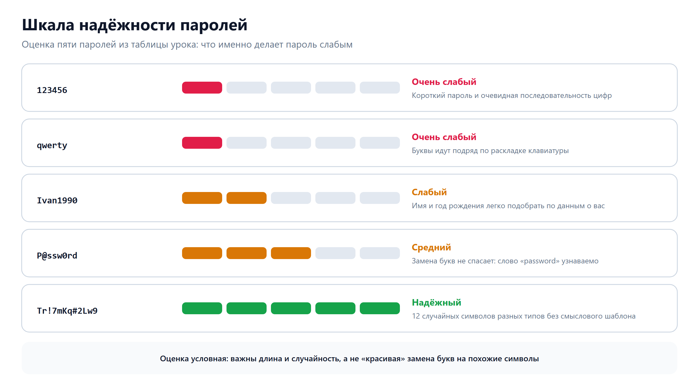{width=1290px height=710px}

**Рисунок 32 — Пять паролей из таблицы урока: оценка от «очень слабого» до «надёжного» и причина оценки**

---

## 4. Защита личной информации. Цифровой след

### 4.1. Персональные данные

> **Определение.** **Персональные данные** — любая информация, относящаяся к определённому физическому лицу и позволяющая его идентифицировать.

К персональным данным относятся:
- фамилия, имя, отчество;
- дата и место рождения;
- домашний адрес, номер телефона;
- паспортные данные, номер СНИЛС;
- данные банковских карт;
- фотографии, на которых вас можно узнать;
- данные о местоположении (геолокация).

В Российской Федерации защита персональных данных регулируется **Федеральным законом № 152-ФЗ «О персональных данных»**.

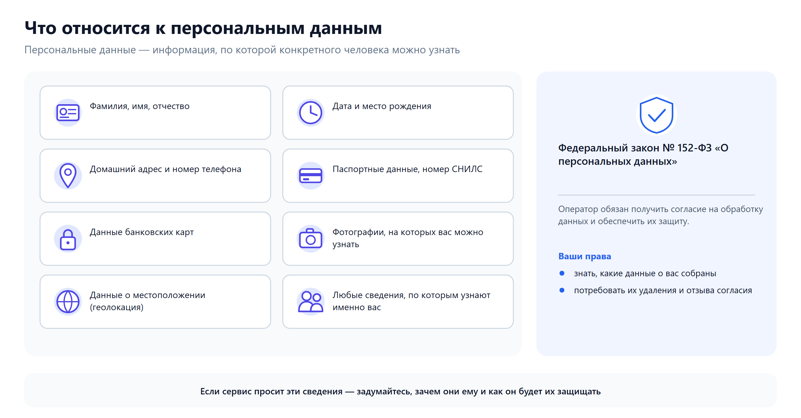{width=1320px height=690px}

**Рисунок 33 — Семь категорий персональных данных и защита по Федеральному закону № 152-ФЗ**

### 4.2. Цифровой след

> **Определение.** **Цифровой след** — совокупность всех данных, которые пользователь оставляет в цифровом пространстве в результате своей активности.

Цифровой след включает:

| Активный след (вы создаёте осознанно) | Пассивный след (собирается автоматически) |
|---------------------------------------|------------------------------------------|
| Посты, комментарии, фото в соцсетях | История поиска в браузере |
| Сообщения в мессенджерах | Данные о геолокации |
| Заполненные анкеты и формы | Файлы cookie на сайтах |
| Загруженные видео, музыка | Данные об устройстве и браузере |
| Регистрации на сайтах | История покупок и просмотров |

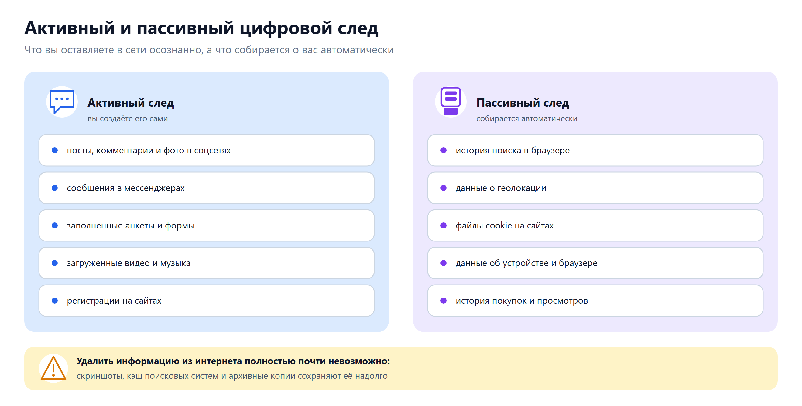{width=1320px height=670px}

**Рисунок 34 — Что пользователь публикует сам, а что о нём собирается автоматически, и почему след не удалить**

**Важно понимать:**
- Удалить информацию из Интернета полностью практически невозможно. Даже удалённый пост может быть сохранён другими пользователями (скриншоты, кэши поисковых систем, архивные копии).
- Ваш цифровой след может быть использован как в позитивных (персонализация рекомендаций), так и в негативных целях (шантаж, манипуляция, дискриминация при приёме на работу).

### 4.3. Правила защиты личной информации

1. **Не публикуйте** в открытом доступе: домашний адрес, номер телефона, номер школы, расписание занятий, данные документов.
2. **Проверяйте настройки приватности** в социальных сетях. Ограничьте видимость личной информации кругом друзей.
3. **Не отправляйте** фото документов, билетов, банковских карт в мессенджерах и по электронной почте.
4. **Оценивайте, какие данные запрашивает сервис** при регистрации. Если фонарик на телефоне просит доступ к контактам и геолокации — это подозрительно.
5. **Используйте разные электронные адреса** для разных целей: один для официальных сервисов, другой для форумов и развлекательных сайтов.
6. **Проверяйте защищённость соединения** (значок замка и `https://` в адресной строке) перед вводом паролей и данных карт.
7. **Регулярно обновляйте** операционную систему, браузер и приложения. Обновления часто содержат исправления уязвимостей.

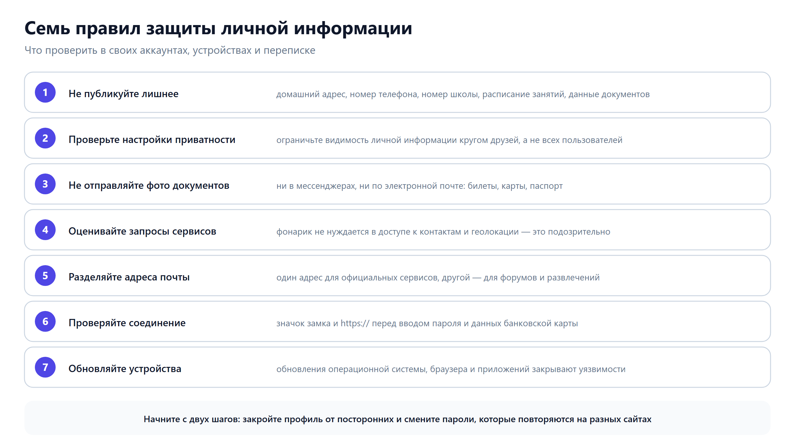{width=1300px height=730px}

**Рисунок 35 — Что проверить в аккаунтах, переписке и настройках приватности**

### 4.4. Сетевая анонимность и аутентичность

В Интернете существует явление **сетевой анонимности**: пользователь может скрыть или исказить свою личность. Это создаёт две проблемы:

- **Ложная анонимность** — ощущение, что «никто не узнает», провоцирует на безответственные поступки.
- **Подмена личности** — злоумышленник может выдавать себя за другого человека или организацию.

**Аутентичность** — подтверждение того, что ресурс или пользователь действительно является тем, за кого себя выдаёт. Проверяется с помощью:
- официального доменного имени сайта;
- сертификата безопасности (значок замка);
- верифицированных аккаунтов в социальных сетях.

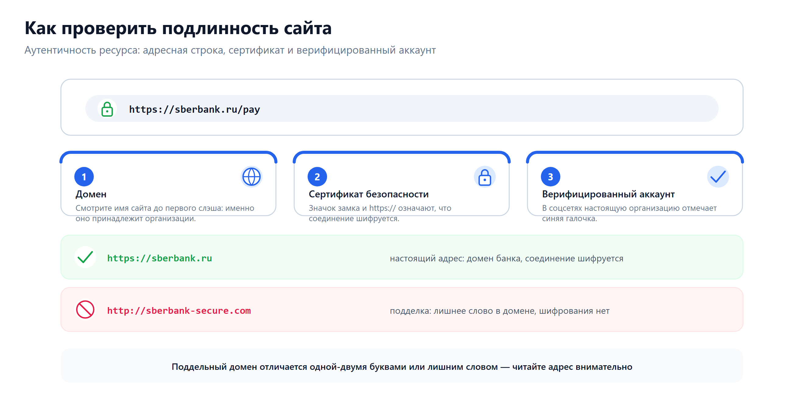{width=1320px height=650px}

**Рисунок 36 — Домен, сертификат безопасности и верифицированный аккаунт: настоящий и поддельный адрес**

---

## 5. Деструктивные и криминальные формы сетевой активности

### 5.1. Кибербуллинг

> **Определение.** **Кибербуллинг** (кибертравля) — целенаправленная, систематическая агрессия и травля человека с использованием цифровых технологий.

**Формы кибербуллинга:**
- оскорбительные, унижающие сообщения в личных чатах или комментариях;
- распространение ложной, компрометирующей информации или личных фотографий без согласия;
- создание поддельных аккаунтов от имени жертвы;
- исключение из групповых чатов, игнорирование как форма давления;
- массовая травля в комментариях («хейт-кампания»).

**Отличие от обычного конфликта:** кибербуллинг носит **систематический** характер, направлен на **конкретную жертву** и преследует цель **унизить, запугать или изолировать**.

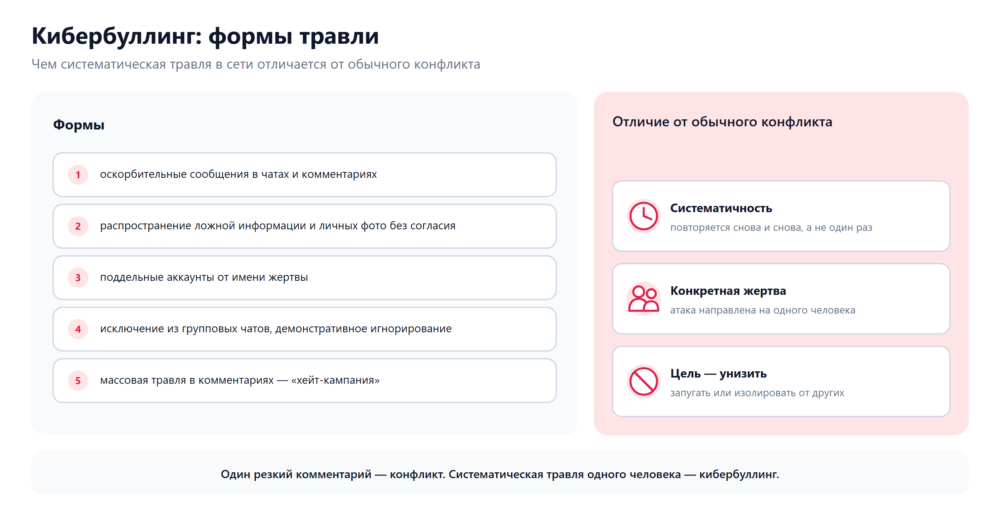{width=1280px height=650px}

**Рисунок 37 — Пять форм сетевой травли и три признака, которые отличают её от обычной ссоры**

**Что делать, если вы столкнулись с кибербуллингом:**

1. **Не отвечайте агрессией на агрессию.** Ответная реакция часто усиливает травлю.
2. **Сохраните доказательства.** Сделайте скриншоты оскорбительных сообщений, комментариев, публикаций.
3. **Заблокируйте обидчика** в мессенджере или социальной сети.
4. **Пожалуйтесь администрации платформы** (кнопка «Пожаловаться», «Сообщить о нарушении»).
5. **Расскажите взрослому**, которому доверяете: родителю, учителю, школьному психологу.
6. **В серьёзных случаях** (угрозы жизни, шантаж, распространение личных фото) обратитесь в полицию. Кибербуллинг может квалифицироваться как правонарушение.

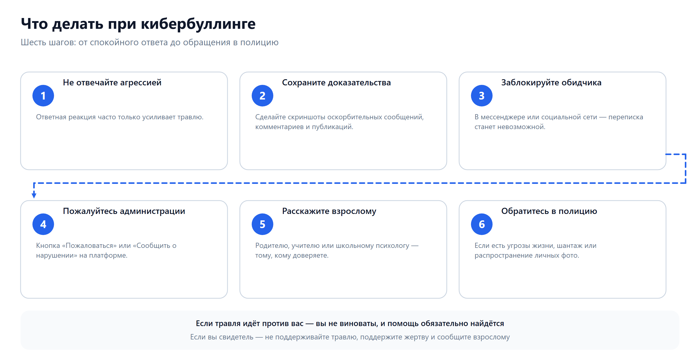{width=1360px height=700px}

**Рисунок 38 — Порядок действий от спокойного ответа до обращения в полицию, а также помощь свидетеля**

**Что делать, если вы стали свидетелем кибербуллинга:**
- Не поддерживайте травлю: не ставьте лайки под оскорблениями, не пересылайте компрометирующие материалы.
- Поддержите жертву: напишите ей, что она не одна.
- Сообщите о ситуации администрации платформы или взрослому.

### 5.2. Фишинг и мошенничество

Фишинг как вид мошенничества был рассмотрен в разделе 2.2. Здесь дополним типичными схемами:

| Схема | Описание |
|-------|----------|
| **«Вы выиграли приз»** | Сообщение о крупном выигрыше, для получения которого нужно «оплатить налог» или ввести данные карты |
| **«Помощь другу»** | Взломанный аккаунт друга рассылает просьбы одолжить деньги |
| **«Подтвердите аккаунт»** | Письмо о якобы блокировке аккаунта с ссылкой на поддельную страницу входа |
| **«Лёгкий заработок»** | Предложение работы, требующее предоплаты, перевода денег или передачи личных данных |

### 5.3. Вовлечение в деструктивные сообщества

В социальных сетях и мессенджерах существуют группы, которые:
- пропагандируют экстремизм и насилие;
- вербуют участников в криминальные схемы;
- распространяют запрещённый контент;
- вовлекают подростков в опасные «челленджи» и деструктивные игры.

**Признаки вовлечения:**
- вам пишут незнакомцы с предложением «эксклюзивного заработка», «участия в секретном проекте»;
- вас приглашают в закрытые группы с агрессивной или экстремистской риторикой;
- вам предлагают совершить действия, нарушающие закон или представляющие опасность для жизни и здоровья.

**Что делать:**
- Не вступайте в переписку.
- Заблокируйте пользователя.
- Пожалуйтесь администрации платформы.
- Расскажите взрослому.
- В случае угроз или вербовки — обратитесь в полицию.

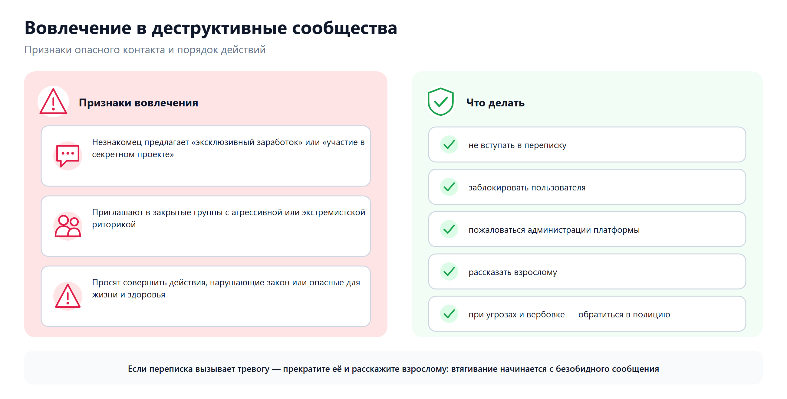{width=1300px height=660px}

**Рисунок 39 — Три признака опасного контакта и пять действий, которые нужно предпринять**

---

## 6. Безопасные стратегии поведения в Интернете

Обобщим всё изученное в виде **свода правил безопасного поведения**:

### Технические меры

- Установите и регулярно обновляйте антивирусное ПО.
- Обновляйте операционную систему, браузер и приложения.
- Используйте двухфакторную аутентификацию.
- Проверяйте наличие `https://` и значка замка при вводе паролей и данных карт.
- Не подключайте неизвестные USB-накопители.

### Поведенческие меры

- Используйте уникальные сложные пароли для каждого сервиса.
- Не сообщайте пароли, коды из СМС и данные карт никому.
- Не переходите по подозрительным ссылкам в письмах и сообщениях.
- Проверяйте адрес сайта перед вводом пароля.
- Не скачивайте файлы из непроверенных источников.
- Осторожно относитесь к предложениям «лёгкого заработка» и «выигрышей».

### Защита личной информации

- Не публикуйте персональные данные в открытом доступе.
- Проверяйте настройки приватности в социальных сетях.
- Помните о цифровом следе: всё, что вы публикуете, сохраняется.
- Оценивайте, какие данные запрашивает сервис при регистрации.

### Противодействие деструктивным формам

- Не поддавайтесь на провокации и давление.
- Сохраняйте доказательства (скриншоты).
- Блокируйте обидчиков и мошенников.
- Сообщайте администрации платформы.
- Обращайтесь за помощью к взрослым и в правоохранительные органы.

### Критическое мышление

- Если предложение выглядит слишком хорошим, чтобы быть правдой, — скорее всего, это обман.
- Если вас торопят и давят на эмоции — остановитесь и подумайте.
- Проверяйте информацию из нескольких источников.
- Не принимайте важных решений в состоянии стресса.

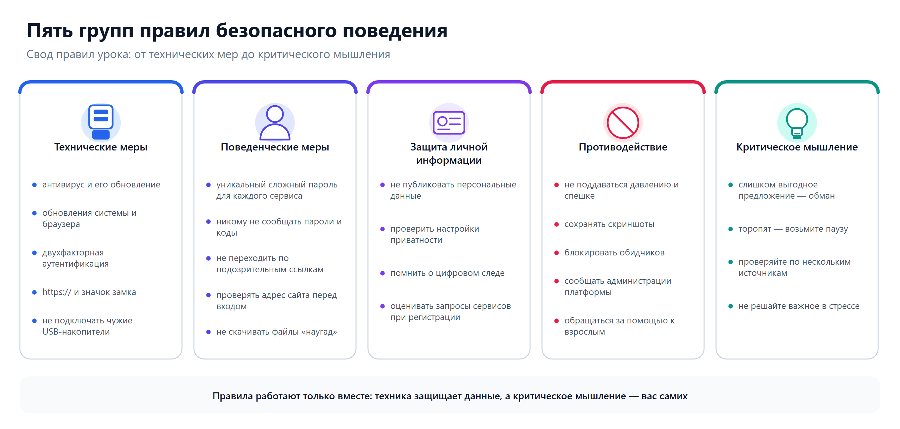{width=1360px height=650px}

**Рисунок 40 — Технические меры, поведение, защита личных данных, противодействие и критическое мышление**

---

## 7. Ключевые термины урока

| Термин | Определение |
|--------|-------------|
| Информационная безопасность | Защищённость данных от несанкционированного доступа, разглашения, подмены, уничтожения |
| Конфиденциальность | Доступность данных только тем, кому они предназначены |
| Целостность | Неизменность данных без ведома владельца |
| Доступность | Возможность владельца пользоваться данными в нужный момент |
| Вредоносное ПО | Программы, созданные для нанесения вреда пользователю или его данным |
| Фишинг | Мошенничество через поддельные сайты и письма с целью выманивания данных |
| Социальная инженерия | Манипулирование людьми для получения конфиденциальной информации |
| Аутентификация | Проверка подлинности пользователя при входе в систему |
| Двухфакторная аутентификация | Подтверждение входа двумя способами (пароль + код из СМС) |
| Персональные данные | Информация, относящаяся к определённому лицу и позволяющая его идентифицировать |
| Цифровой след | Совокупность данных, оставляемых пользователем в цифровом пространстве |
| Кибербуллинг | Целенаправленная травля человека с использованием цифровых технологий |
| Сетевая анонимность | Возможность скрыть или исказить свою личность в Интернете |
| Аутентичность | Подтверждение того, что ресурс или пользователь является тем, за кого себя выдаёт |

---

## 8. Вопросы для самопроверки

1. Что такое информационная безопасность? Какие три свойства данных она обеспечивает?
2. Чем технические угрозы отличаются от социально-психологических? Приведите примеры.
3. Перечислите основные виды вредоносного программного обеспечения.
4. Что такое фишинг? Назовите не менее четырёх признаков фишингового письма.
5. Что такое социальная инженерия? Почему она часто эффективнее технических атак?
6. Что такое аутентификация? Какие три фактора аутентификации вы знаете?
7. Сформулируйте не менее пяти правил создания надёжного пароля.
8. Что такое двухфакторная аутентификация и зачем она нужна?
9. Что относится к персональным данным? Какой закон защищает их в России?
10. Что такое цифровой след? Чем активный цифровой след отличается от пассивного?
11. Что такое кибербуллинг? Чем он отличается от обычного конфликта?
12. Перечислите действия, которые необходимо предпринять при столкновении с кибербуллингом.
13. Почему опасно вводить данные карты при подключении к открытому Wi-Fi?
14. Что такое аутентичность ресурса и как её проверить?
15. Сформулируйте три главных правила безопасного поведения в Интернете.

**Задания по рисункам**

16. По рисунку 26 определите, какие признаки выдают фишинговое письмо, и объясните, почему поддельный домен `vk-support-check.ru` легко спутать с настоящим.
17. По рисунку 30 определите, к какому фактору аутентификации относится каждый способ входа: пароль, код из СМС, отпечаток пальца. Какой уровень защиты у каждого фактора?
18. По рисунку 34 разделите на две группы: пост в социальной сети, история поиска в браузере, фотография в мессенджере, данные геолокации, заполненная анкета. Что относится к активному следу, а что — к пассивному?
19. По рисунку 32 объясните, почему пароль `P@ssw0rd` получил оценку «средний», а не «надёжный», и предложите замену.

---

## 9. Задания для закрепления

**Задание 1.** Проанализируйте письмо и определите, является ли оно фишинговым. Обоснуйте ответ, указав конкретные признаки.

> *Тема: «Срочно! Ваш аккаунт заблокирован»*
> *От: security@vk-support-check.ru*
> *Текст: «Уважаемый пользователь! Мы зафиксировали подозрительную активность в вашем аккаунте ВКонтакте. Для разблокировки перейдите по ссылке в течение 2 часов: http://vk-support-check.ru/verify. Введите логин и пароль. Если вы не выполните действие, аккаунт будет удалён безвозвратно. С уважением, Служба поддержки ВКонтакте.»*

**Задание 2.** Оцените надёжность следующих паролей. Для каждого укажите слабые места и предложите улучшенный вариант.

- `maria2009`
- `Qw123456`
- `X#9mR!pL2vT`
- `password`

**Задание 3.** Составьте **чек-лист** из 8–10 пунктов: «Что я должен проверить, чтобы защитить свои аккаунты и личные данные». Оформите в виде таблицы с колонками: «Что проверить», «Как проверить», «Зачем это нужно».

**Задание 4.** Опишите ситуацию: в классном чате кто-то начал распространять оскорбительные мемы об одном из учеников. Составьте план действий (не менее 5 шагов), объяснив, почему каждый шаг важен.

---

*Материал подготовлен в соответствии с Федеральной рабочей программой по информатике (ID 11736449), раздел 1 «Цифровая грамотность», тема 1.1 «Глобальная сеть Интернет и стратегии безопасного поведения в ней», 9 класс.*