# Глобальная сеть Интернет. IP-адреса узлов. Большие данные

## Теоретический материал. Информатика. 9 класс. Урок 1

---

## 1. Что такое Интернет и как он устроен

### 1.1. Определение

**Интернет** (от англ. *International Network* — «международная сеть») — это глобальная система объединённых компьютерных сетей, покрывающая практически весь мир. Это не один огромный компьютер и не один кабель, а колоссальное количество сетей, соединённых между собой и «говорящих» на общем языке — наборе протоколов **TCP/IP**.

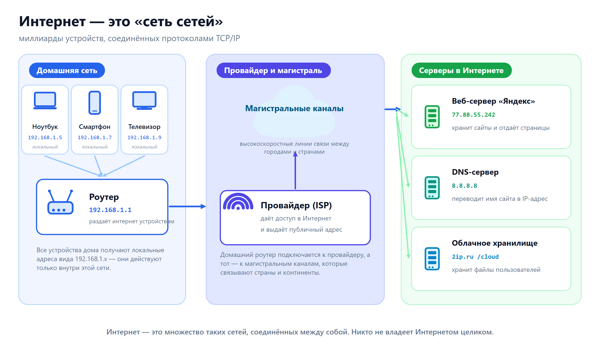{width=1280px height=760px}

**Рисунок 1 — Интернет — это «сеть сетей»: домашние устройства, провайдер, магистральные каналы и серверы**

Протокол **TCP** (Transmission Control Protocol) отвечает за то, чтобы данные были разбиты на части, доставлены адресату и собраны в правильном порядке. Протокол **IP** (Internet Protocol) отвечает за адресацию: он гарантирует, что каждый пакет данных знает, куда ему нужно попасть.

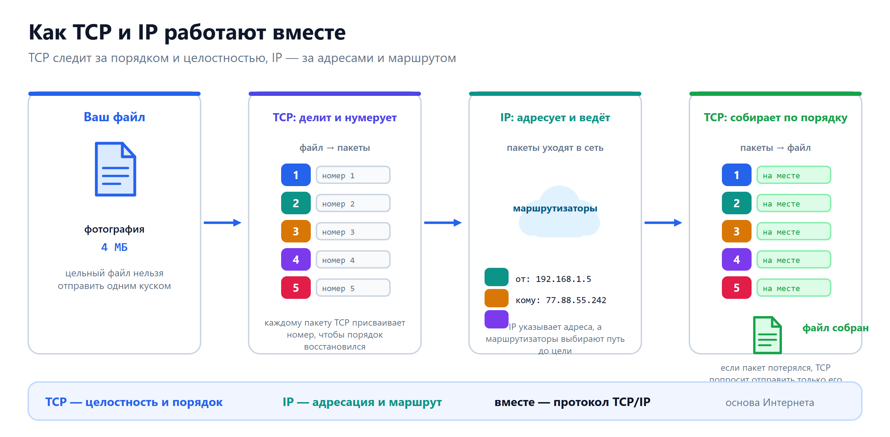{width=1260px height=620px}

**Рисунок 2 — TCP следит за порядком и целостностью данных, IP — за адресами и маршрутом**

### 1.2. Основные элементы сети

Представьте себе огромную систему дорог, по которой ездят автомобили (данные). В этой системе есть:

| Элемент | Аналогия с дорогой | Роль в Интернете |
|---------|-------------------|-----------------|
| **Узел (хост)** | Дом, куда едет машина | Любое устройство, подключённое к сети: компьютер, смартфон, сервер, умный телевизор |
| **Маршрутизатор (роутер)** | Перекрёсток со светофором | Устройство, которое перенаправляет данные между сегментами сети, выбирая оптимальный путь |
| **Сервер** | Склад или магазин | Мощный компьютер, который хранит информацию и предоставляет услуги другим устройствам |
| **Клиент** | Покупатель, приехавший на склад | Ваше устройство или программа, которая запрашивает данные у сервера |
| **Провайдер (ISP)** | Дорожная компания, обслуживающая трассы | Организация, предоставляющая вам доступ в Интернет |
| **Магистральный канал** | Скоростное шоссе между городами | Высокоскоростные каналы связи между крупными узлами сети |

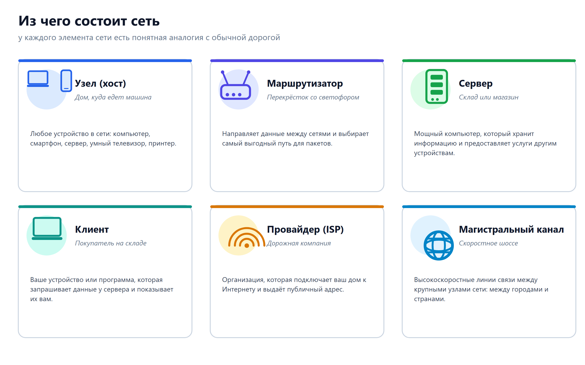{width=1280px height=800px}

**Рисунок 3 — Шесть элементов сети и их аналогии с обычной дорогой**

### 1.3. Как данные путешествуют по сети

Когда вы вводите в браузере адрес сайта и нажимаете Enter, происходит следующее:

1. Ваш компьютер отправляет **запрос** к серверу, на котором хранится нужный сайт.
2. Запрос разбивается на небольшие **пакеты** (обычно около 1500 байт каждый).
3. Каждый пакет снабжается **адресом отправителя** и **адресом получателя**.
4. Пакеты отправляются в сеть и могут двигаться **разными маршрутами** через различные маршрутизаторы.
5. На стороне сервера пакеты собираются в исходном порядке и обрабатываются.
6. Сервер формирует **ответ** (например, веб-страницу), который тоже разбивается на пакеты и отправляется обратно.

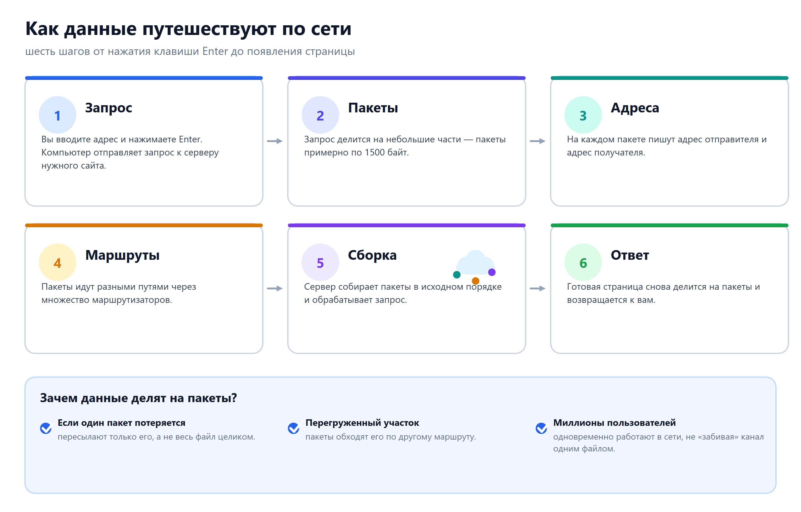{width=1280px height=820px}

**Рисунок 4 — Шесть шагов: от нажатия клавиши Enter до появления страницы на экране**

> **Почему данные разбиваются на пакеты?**
> - Если один пакет потеряется, не нужно пересылать всё заново — достаточно повторно отправить только его.
> - Пакеты могут обходить перегруженные участки сети разными путями.
> - Сетью могут одновременно пользоваться миллионы устройств, не «забивая» канал одним большим файлом.

---

## 2. IP-адреса узлов

### 2.1. Зачем нужен адрес

В реальном мире, чтобы письмо дошло до адресата, на конверте пишут почтовый адрес: страну, город, улицу, дом. В Интернете роль такого адреса выполняет **IP-адрес**.

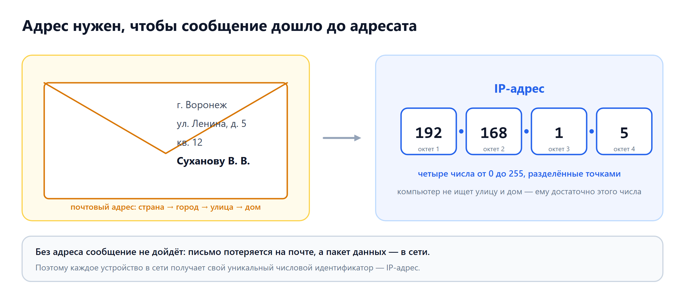{width=1240px height=540px}

**Рисунок 5 — Почтовый адрес нужен письму так же, как IP-адрес — пакету данных**

> **Определение.** **IP-адрес** (Internet Protocol address) — это уникальный числовой идентификатор устройства в компьютерной сети, работающей по протоколу IP.

Без IP-адреса сеть не смогла бы отличить ваш компьютер от миллиардов других устройств и не знала бы, куда доставлять данные.

### 2.2. Формат IPv4

Наиболее распространённый сегодня формат — **IPv4** (четвёртая версия протокола).

**Формат IPv4:** четыре числа от 0 до 255, разделённых точками.

**Примеры:**
- `192.168.0.1`
- `8.8.8.8` (сервер DNS компании Google)
- `93.184.216.34`

Каждое из четырёх чисел называется **октетом** и занимает ровно 8 бит (1 байт). Итого весь IPv4-адрес занимает **32 бита** (4 байта).

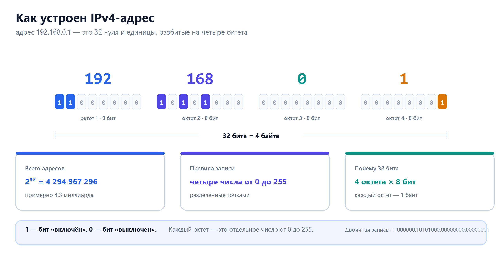{width=1280px height=660px}

**Рисунок 6 — Адрес 192.168.0.1: четыре октета по 8 бит, всего 32 бита**

### 2.3. Двоичное представление

Поскольку компьютер работает с двоичными числами, IP-адрес на самом деле хранится как последовательность из 32 нулей и единиц.

**Пример перевода:**

| Десятичная запись | Двоичная запись (8 бит) |
|---|---|
| 192 | 11000000 |
| 168 | 10101000 |
| 0 | 00000000 |
| 1 | 00000001 |

Полный двоичный вид адреса `192.168.0.1`:

```
11000000.10101000.00000000.00000001
```

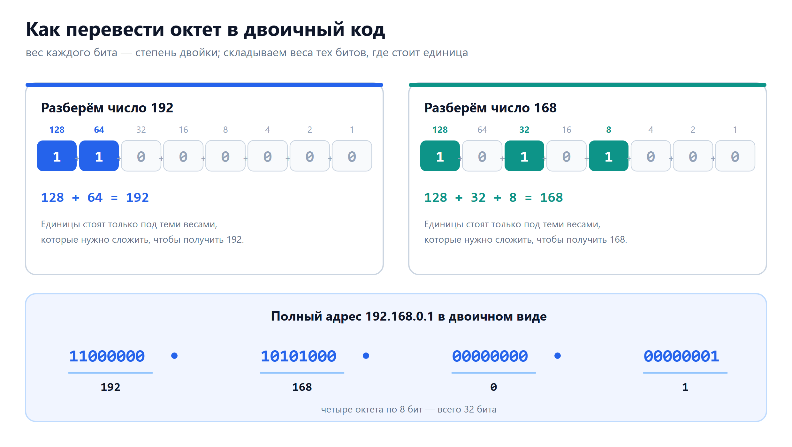{width=1240px height=700px}

**Рисунок 7 — Как складывать веса битов: 128 + 64 = 192, 128 + 32 + 8 = 168**

### 2.4. Сколько адресов в IPv4

Максимальное количество уникальных адресов IPv4:

$$2^{32} = 4\,294\,967\,296 \approx 4{,}3 \text{ млрд}$$

Казалось бы, это очень много. Однако число устройств, подключённых к Интернету, уже превысило 15 миллиардов (смартфоны, компьютеры, умные часы, датчики, автомобили и т. д.). Поэтому адресов IPv4 стало **не хватать**.

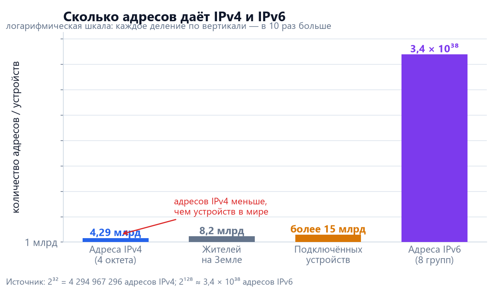{width=1290px height=750px}

**Рисунок 8 — Адресов IPv4 меньше, чем устройств в мире (логарифмическая шкала)**

### 2.5. Формат IPv6

Для решения проблемы нехватки адресов была разработана версия **IPv6**.

**Формат IPv6:** восемь групп по четыре шестнадцатеричных цифры, разделённых двоеточиями.

**Пример:**
```
2001:0db8:85a3:0000:0000:8a2e:0370:7334
```

Каждая группа — 16 бит. Итого: 8 × 16 = **128 бит**.

Количество возможных адресов:

$$2^{128} \approx 3{,}4 \times 10^{38}$$

Это число настолько велико, что можно присвоить уникальный адрес каждой песчинке на Земле и всё равно останутся неиспользованные адреса.

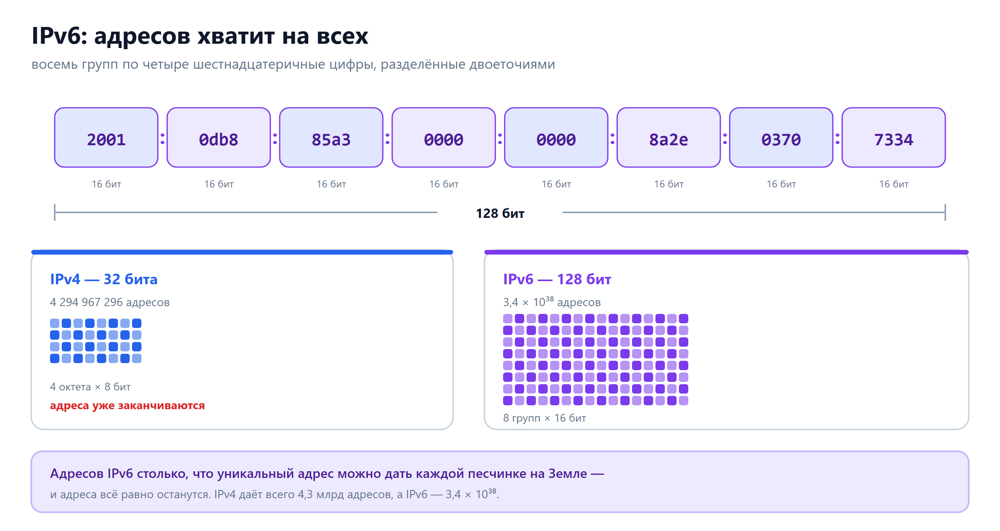{width=1280px height=680px}

**Рисунок 9 — Восемь групп по 16 бит против четырёх октетов IPv4**

### 2.6. Публичный и локальный адреса

Различают два вида IP-адресов:

| Вид | Где используется | Пример | Кто присваивает |
|-----|-----------------|--------|----------------|
| **Публичный (внешний)** | В глобальной сети Интернет, уникален во всём мире | `93.184.216.34` | Провайдер |
| **Локальный (частный)** | Внутри домашней или корпоративной сети | `192.168.1.5`, `10.0.0.1` | Роутер |

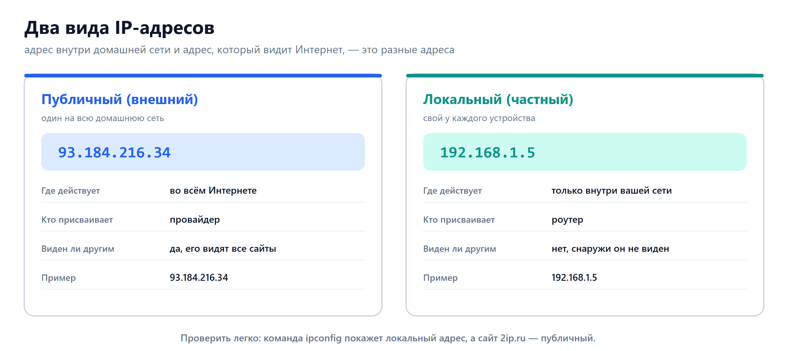{width=1300px height=580px}

**Рисунок 10 — Чем публичный адрес отличается от локального**

Локальные адреса из диапазона `192.168.x.x` или `10.x.x.x` не видны за пределами вашей сети. Когда вы выходите в Интернет, ваш роутер «подставляет» публичный адрес для всех устройств домашней сети. Этот механизм называется **NAT** (Network Address Translation).

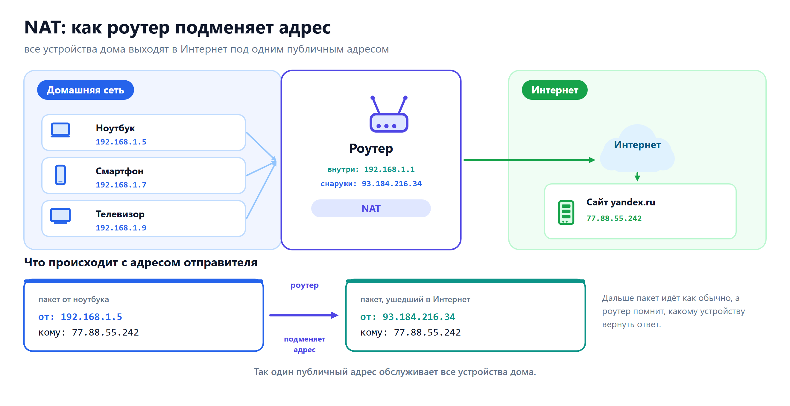{width=1320px height=680px}

**Рисунок 11 — NAT: роутер заменяет локальный адрес отправителя на публичный**

### 2.7. Как узнать свой IP-адрес

- **Локальный адрес** (в ОС Windows): откройте командную строку → введите `ipconfig` → найдите строку «IPv4-адрес».
- **Публичный адрес**: откройте браузер и перейдите на сайт `2ip.ru` или `whatismyip.com`.

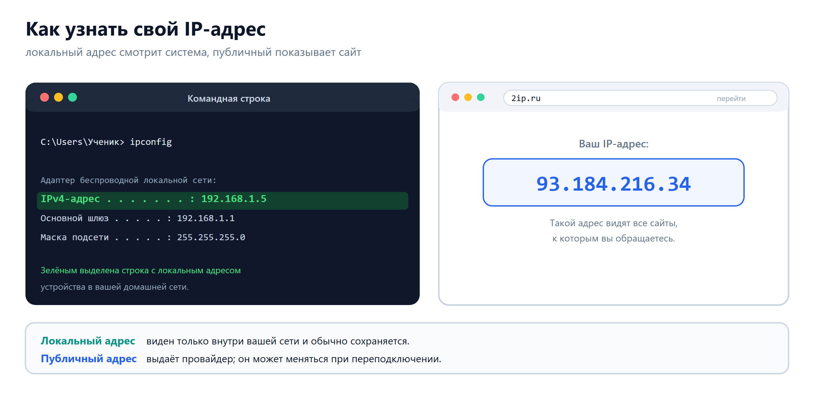{width=1280px height=620px}

**Рисунок 12 — Командная строка показывает локальный адрес, сайт 2ip.ru — публичный**

### 2.8. Доменные имена (DNS)

Запоминать числовые адреса неудобно. Поэтому существует система **доменных имён** — текстовые адреса, которые мы видим в браузере:

- `yandex.ru`
- `wikipedia.org`
- `edsoo.ru`

Специальные серверы **DNS** (Domain Name System) переводят доменное имя в IP-адрес. Когда вы вводите в браузере `yandex.ru`, DNS-сервер сообщает вашему компьютеру: «Этот сайт находится по адресу `77.88.55.242`», и соединение устанавливается.

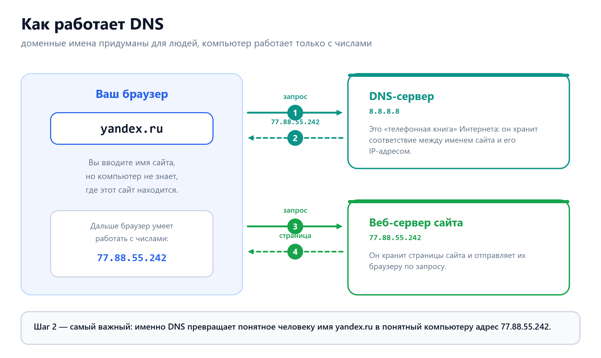{width=1140px height=680px}

**Рисунок 13 — DNS превращает понятное человеку имя сайта в понятный компьютеру IP-адрес**

---

## 3. Большие данные (Big Data)

### 3.1. Что это такое

Каждую секунду в мире генерируются огромные объёмы информации:

- пользователи социальных сетей публикуют посты, фото и видео;
- поисковые системы обрабатывают миллиарды запросов;
- банкоматы, терминалы и онлайн-магазины фиксируют миллионы транзакций;
- умные устройства (датчики, камеры, автомобили) непрерывно передают телеметрию;
- навигационные сервисы собирают данные о перемещениях миллионов людей.

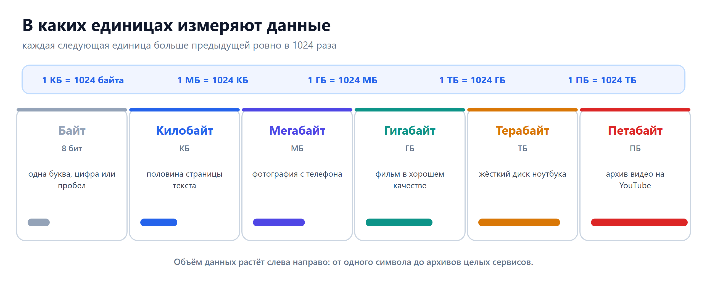{width=1280px height=520px}

**Рисунок 14 — В каких единицах измеряют данные: от байта до петабайта**

> **Определение.** **Большие данные** (англ. *Big Data*) — совокупности данных столь большого объёма и сложности, что для их хранения, обработки и анализа традиционные методы и инструменты оказываются недостаточными.

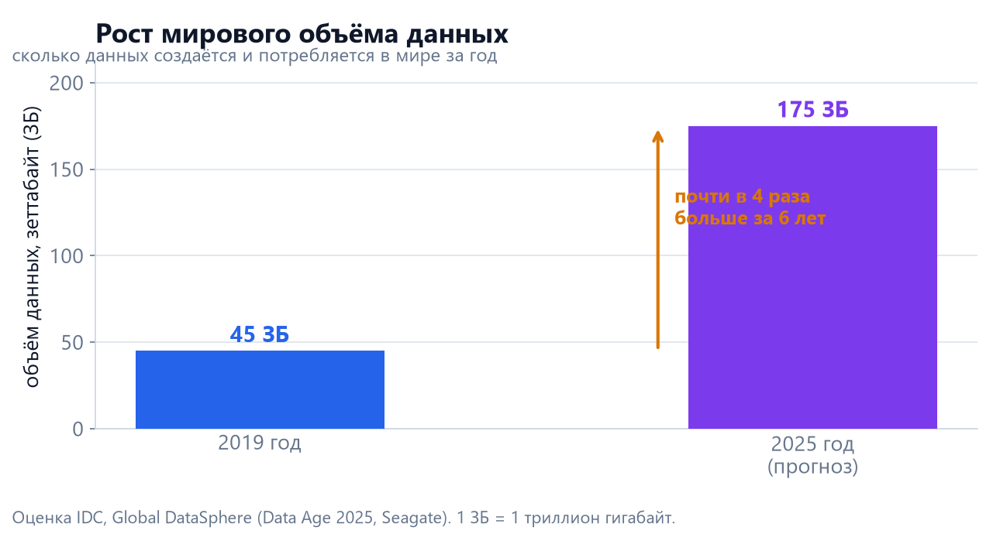{width=1290px height=690px}

**Рисунок 15 — Объём данных в мире растёт почти в 4 раза за шесть лет (оценка IDC)**

### 3.2. Три «V» больших данных

Большие данные традиционно характеризуются тремя ключевыми признаками — **«три V»**:

| Признак | Английское слово | Смысл | Пример |
|---------|-----------------|-------|--------|
| **Объём** | Volume | Данные измеряются в терабайтах и петабайтах | Архив видео на YouTube — сотни петабайт |
| **Скорость** | Velocity | Данные поступают непрерывно и в реальном времени | Поток сообщений в Telegram — миллионы в минуту |
| **Разнообразие** | Variety | Данные имеют разную структуру и формат | Текст, фото, видео, числа, геолокация, аудио |

Иногда добавляют ещё два признака: **достоверность** (Veracity) и **ценность** (Value).

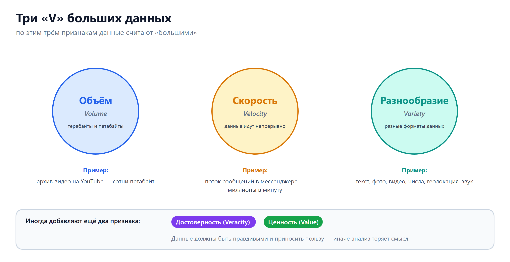{width=1280px height=660px}

**Рисунок 16 — Три «V» и два дополнительных признака больших данных**

### 3.3. Примеры больших данных в повседневной жизни

| Сфера | Источник данных | Что анализируется | Результат для пользователя |
|-------|----------------|-------------------|---------------------------|
| Социальные сети | Посты, лайки, репосты | Интересы и предпочтения | Персонализированная лента новостей |
| Музыкальные сервисы | Прослушанные треки, пропуски | Музыкальный вкус | Рекомендации новых песен |
| Навигаторы | Скорость движения тысяч машин | Загруженность дорог | Построение маршрута с учётом пробок |
| Интернет-магазины | История покупок и просмотров | Покупательское поведение | Подборка товаров «для вас» |
| Медицина | Показания датчиков, анализы | Состояние здоровья пациента | Ранняя диагностика заболеваний |

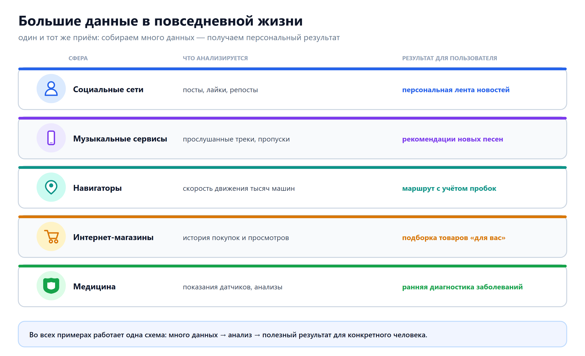{width=1280px height=780px}

**Рисунок 17 — Пять сфер, где большие данные работают каждый день**

### 3.4. Как обрабатывают большие данные

Обработать петабайты данных на одном компьютере невозможно. Для этого используют:

- **Распределённые вычисления** — задача делится между тысячами серверов (например, технология Hadoop, MapReduce);
- **Облачные хранилища** — данные хранятся не на одном сервере, а в огромных центрах обработки данных;
- **Машинное обучение и искусственный интеллект** — алгоритмы находят закономерности в данных без явного программирования.

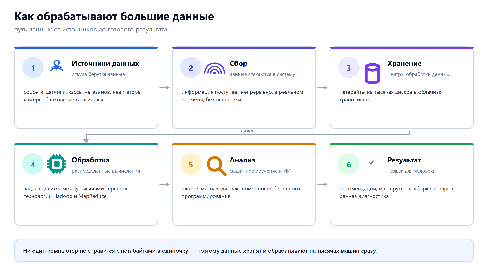{width=1360px height=760px}

**Рисунок 18 — Путь данных: от источников до готового результата**

### 3.5. Риски и этические вопросы

Работа с большими данными поднимает важные вопросы:

- **Приватность.** Сервисы собирают информацию о ваших привычках, перемещениях, интересах. Возникает вопрос: кто и как распоряжается этими данными?
- **Цифровой след.** Всё, что вы публикуете или делаете в сети, сохраняется. Удалить информацию полностью практически невозможно.
- **Утечки данных.** Хранение огромных массивов персональных данных создаёт риск их кражи злоумышленниками.
- **Манипуляция.** На основе анализа больших данных можно целенаправленно влиять на поведение людей (реклама, политические кампании).

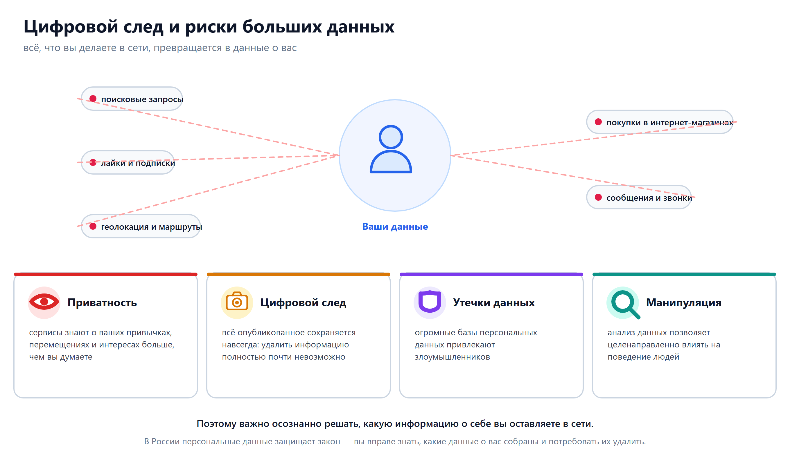{width=1360px height=800px}

**Рисунок 19 — Что попадает в цифровой след и какие риски с этим связаны**

Именно поэтому важно осознанно относиться к тому, какую информацию вы размещаете в сети, и знать свои права на защиту персональных данных.

---

## 4. Сетевое хранение данных

Помимо передачи данных, Интернет предоставляет возможность их **хранения** на удалённых серверах:

- **Облачные хранилища** (Яндекс Диск, Облако Mail, Google Drive) позволяют хранить файлы на серверах и получать к ним доступ с любого устройства.
- **Веб-сервисы** (онлайн-офисы, среды разработки) дают возможность работать с документами и программами прямо в браузере, не устанавливая их на компьютер.

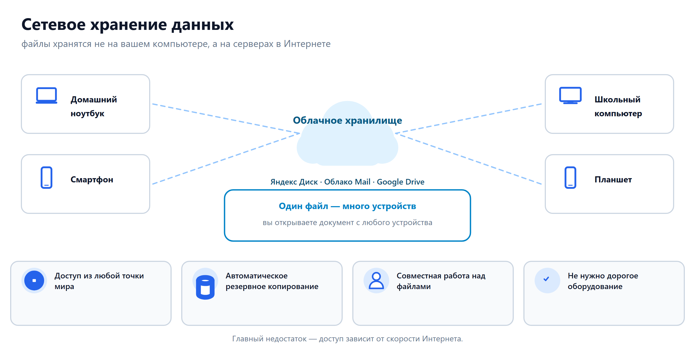{width=1300px height=660px}

**Рисунок 20 — Облачное хранилище: один файл доступен со всех ваших устройств**

Преимущества сетевого хранения:
- доступ к данным из любой точки мира;
- автоматическое резервное копирование;
- возможность совместной работы нескольких пользователей;
- отсутствие необходимости покупать дорогостоящее оборудование.

---

## 5. Методы размещения информации в Интернете

Каждый пользователь может не только потреблять, но и **создавать** контент:

| Метод | Пример | Характер |
|-------|--------|----------|
| Публикация в социальных сетях | Пост, фото, видео, комментарий | Индивидуальный |
| Создание блога или сайта | Личный блог на конструкторе | Индивидуальный |
| Совместная работа над документом | Онлайн-таблица, вики-страница | Коллективный |
| Размещение файлов в облаке | Общая папка с учебными материалами | Коллективный |
| Участие в форумах и обсуждениях | Ответы на вопросы, рецензии | Коллективный |

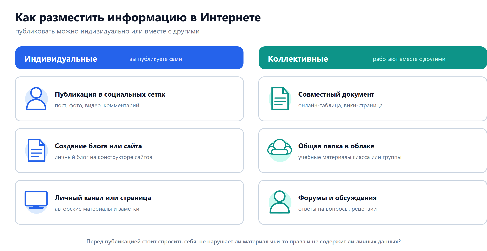{width=1280px height=660px}

**Рисунок 21 — Индивидуальные и коллективные способы публикации информации**

---

## Ключевые термины урока

| Термин | Определение |
|--------|-------------|
| Интернет | Глобальная система объединённых компьютерных сетей |
| TCP/IP | Набор протоколов, по которым работает Интернет |
| Узел (хост) | Любое устройство, подключённое к сети |
| Маршрутизатор | Устройство, перенаправляющее данные между сегментами сети |
| Пакет | Небольшой фрагмент данных с адресами отправителя и получателя |
| IP-адрес | Уникальный числовой идентификатор устройства в сети |
| IPv4 | 32-битный адрес из четырёх чисел (0–255), разделённых точками |
| IPv6 | 128-битный адрес из восьми шестнадцатеричных групп |
| Публичный адрес | Уникальный адрес устройства в глобальной сети |
| Локальный адрес | Адрес устройства внутри домашней или корпоративной сети |
| DNS | Система доменных имён, переводящая текстовые адреса в IP |
| Большие данные | Совокупности данных огромного объёма, скорости и разнообразия |
| «Три V» | Volume (объём), Velocity (скорость), Variety (разнообразие) |
| Цифровой след | Совокупность данных о действиях пользователя в сети |

---

## Вопросы для самопроверки

1. Что такое Интернет? Почему его называют «сетью сетей»?
2. Какие протоколы лежат в основе работы Интернета? За что отвечает каждый из них?
3. Что такое узел сети? Приведите три примера узлов.
4. Зачем данные разбиваются на пакеты перед отправкой?
5. Что такое IP-адрес? Зачем он нужен?
6. Сколько бит занимает адрес IPv4? Сколько уникальных адресов можно записать?
7. Почему потребовался переход на IPv6?
8. Чем отличается публичный IP-адрес от локального?
9. Что такое DNS и зачем она нужна?
10. Что понимают под термином «большие данные»?
11. Назовите три ключевых характеристики больших данных («три V»).
12. Приведите два примера использования больших данных в повседневной жизни.
13. Какие риски связаны со сбором и обработкой больших данных?
14. Что такое цифровой след?

**Задания по рисункам**

15. По рисунку 6 определите, сколько битов занимает один октет. Сложите веса всех битов и объясните, почему получается 255.
16. По рисунку 7 переведите в двоичный код числа 4 и 2. Проверьте себя по рисунку.
17. По рисунку 8 объясните, почему адресов IPv4 перестало хватать человечеству.

---

## Задания для закрепления

**Задание 1.** Переведите в двоичную систему счисления каждый октет IP-адреса `10.0.0.5`. Запишите полный двоичный вид адреса.

**Задание 2.** Определите, какие из перечисленных адресов являются локальными, а какие — публичными:
- `192.168.1.100`
- `8.8.8.8`
- `10.0.0.1`
- `93.184.216.34`

**Задание 3.** Приведите по одному примеру больших данных из каждой сферы: образование, транспорт, здравоохранение. Объясните, какие «три V» в них проявляются.

**Задание 4.** Узнайте свой локальный и публичный IP-адреса. Запишите их и кратко объясните различие.

---

*Материал подготовлен в соответствии с Федеральной рабочей программой по информатике (ID 11736449), раздел 1 «Цифровая грамотность», тема 1.1, 9 класс.*
